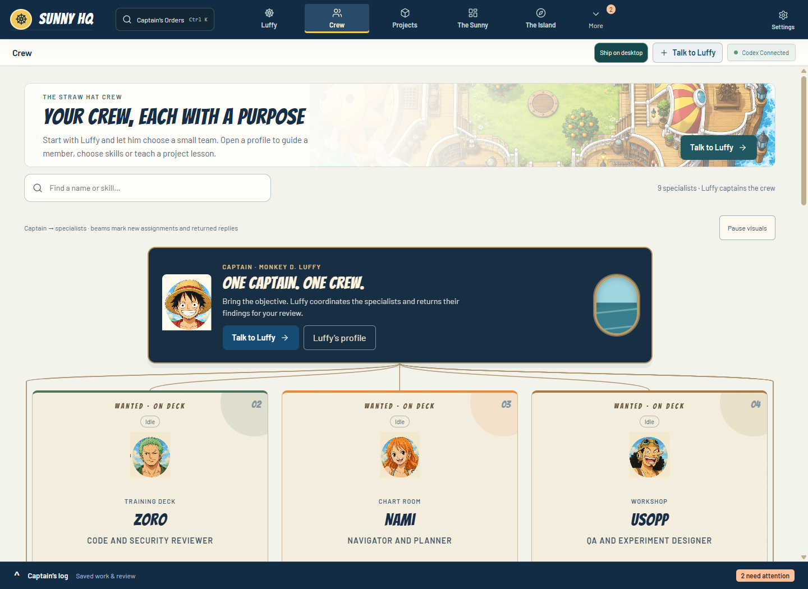
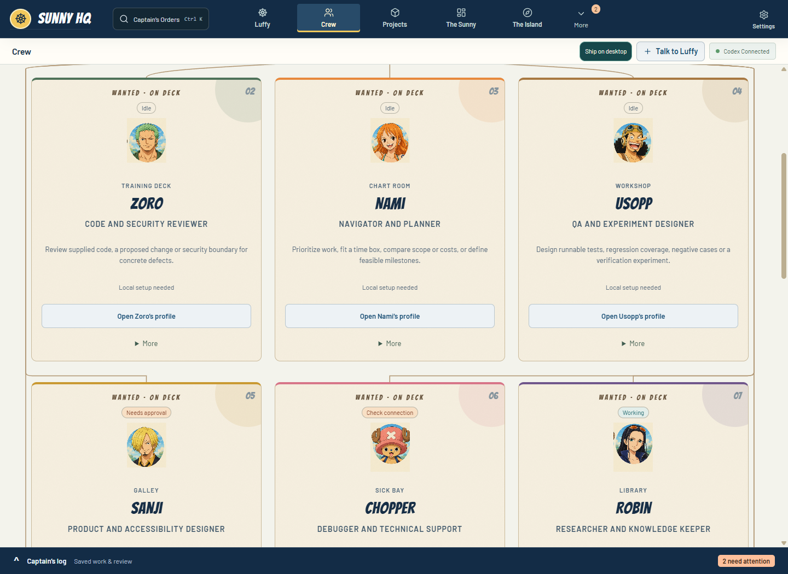
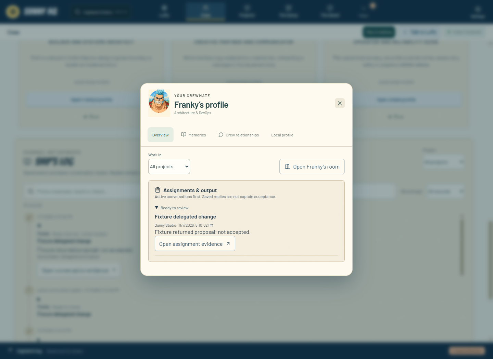
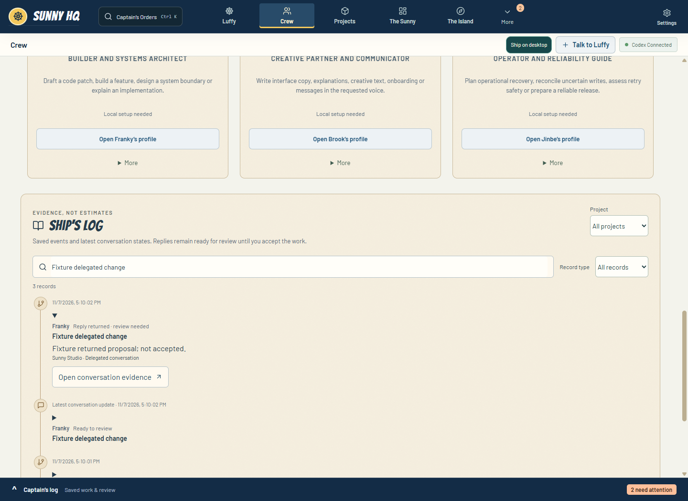
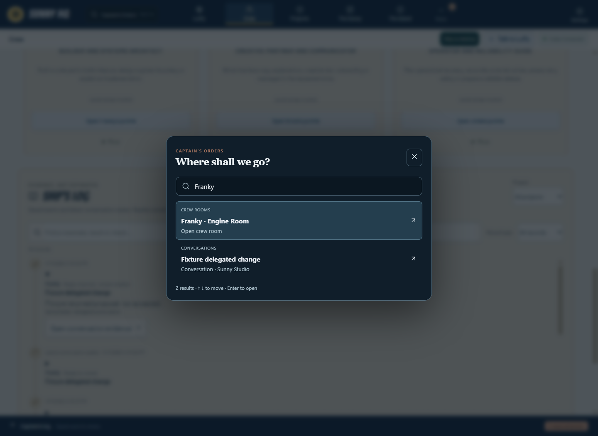
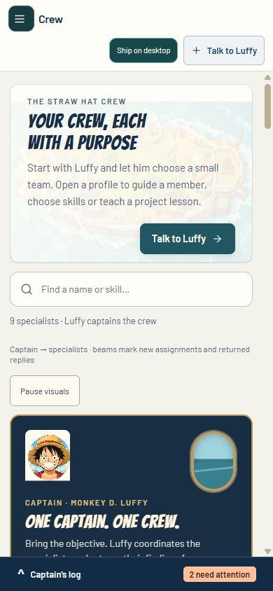
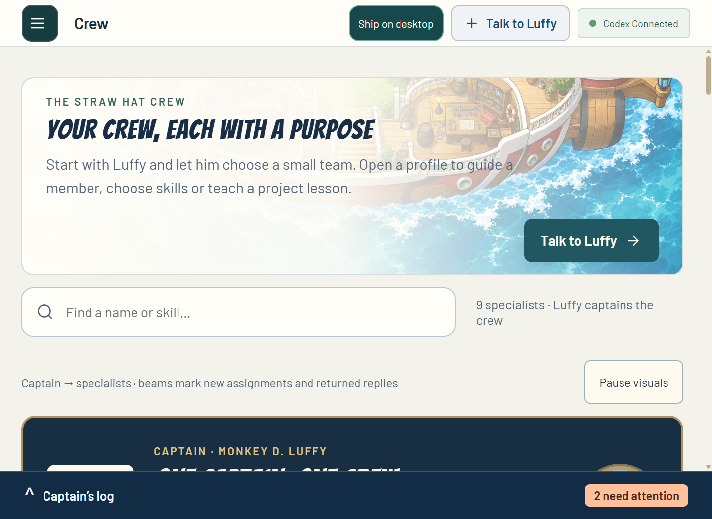

# Crew component research validation — 2026-11-07

Source: isolated `codex/crew-map`, second pass after `009e96a`. Node 24.18.0. No installed application or real provider was modified/tested.

- Final production build and TypeScript: passed. Build fingerprint `58b3b9de974c3a9ab8d676abe764ae7503e12496114382f782bfea7bffb22123`; existing large-chunk warning remains.
- Focused regression: 17 passed, zero failed. See focused-tests.txt.
- Final hidden Electron map fixture: passed. Tests equal-sized core crew cards, distinct captain, one log, work-first profile, keyboard still entrance/focus return, local setup draft retention across profile sections, finite assignment/result pulses, duplicate/remount suppression, pause and OS/app reduced motion, log search, actual mission search/navigation and attempt-bound check evidence, phone/laptop and 200% zoom overflow. Synthetic data only.
- Full native workflow: 68 checks passed against this pass before the final additional static mission-brief texture selector. Receipt workflow-result.json. Final dedicated map fixture used the final build.
- Full npm test: rerun, 167 passed then `genuine durable pre-start batch rejects missing readonly binding without sibling effects` failed with Journey deadline in checkpoint-journey-faults.test.cjs. Stopped after confirming this already baseline-reproduced backend failure; full suite incomplete, not green. Raw local TAP `.sunny-dev/research-tests.log`. No backend production changes in this pass. Separate CI repair worktree remains independent.
- A first expanded navigation test asserted saved context before asynchronous workspace persistence completed; fixed the test to await saved workspace, rerun passed. Product navigation was observed correctly.
- Visually inspected desktop captain/cards, work profile, phone and log screenshots; checked final captain/card rail treatment. No manual screen-reader speech audit or live-provider proof.

## Screenshots

Source rationale and all six adoption decisions: [research](../../crew-components-research-2026-11-07.md), [implementation](../../crew-map-2026-11-07.md). Original static parchment and CSS ocean are deliberate alternatives to the referenced shaders; profile is a native dialog rather than a shared-layout morph.

Final review correction: the captain's council overview displays the council's own status, Zoro displays his review status, and contributors display their own contribution status. Production build/typecheck passed again (`cff23010a0e8a5777ba0d7a852e23999be2964e96c26880d517d31cf455325e6`). Screenshot/native receipts above precede this label-only correction.
