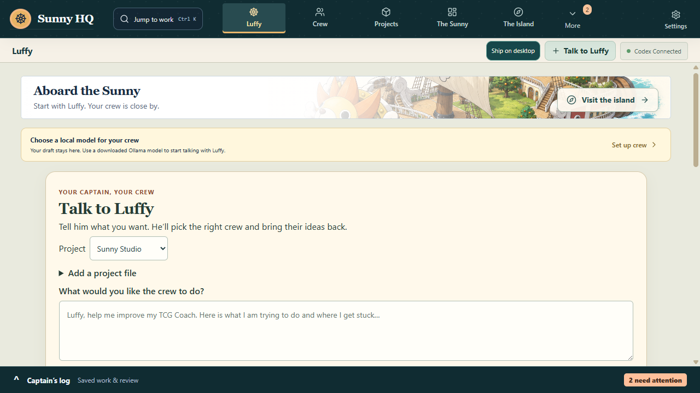
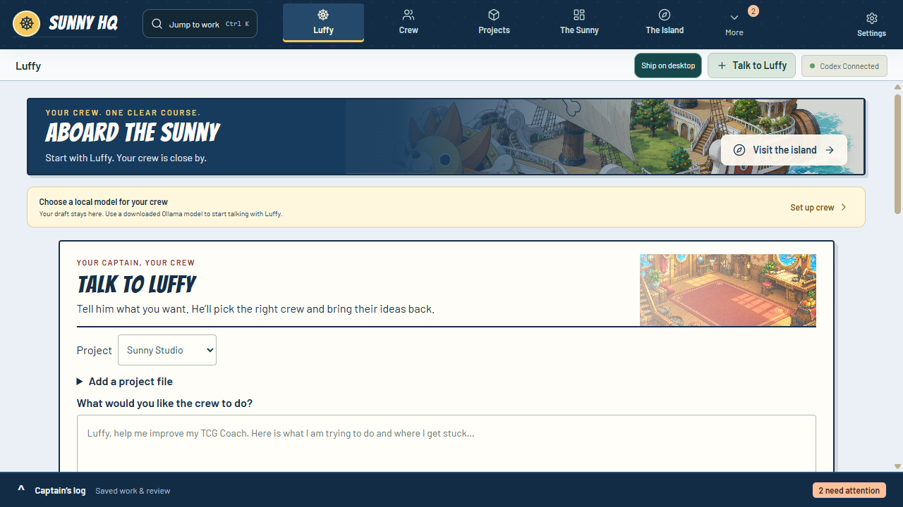
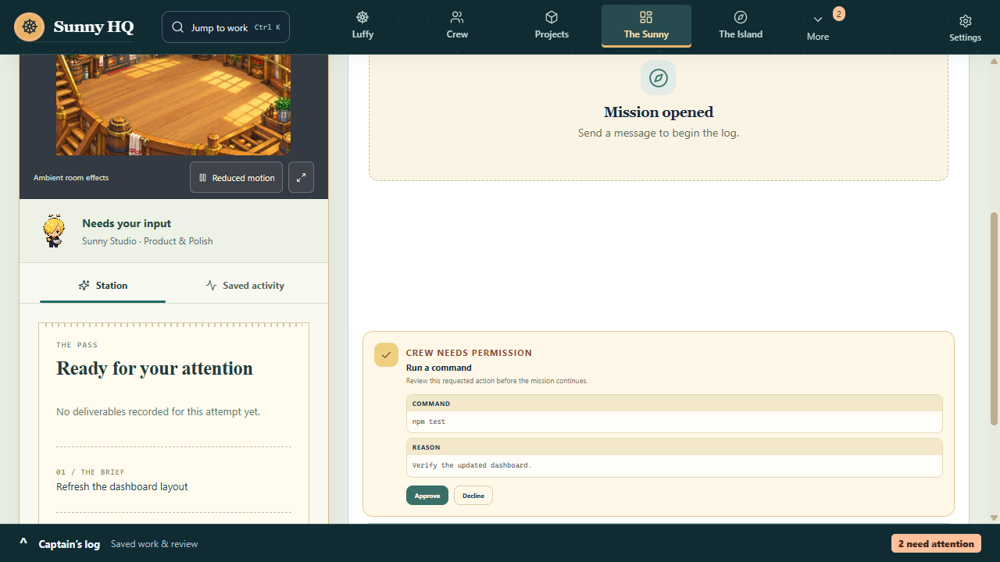
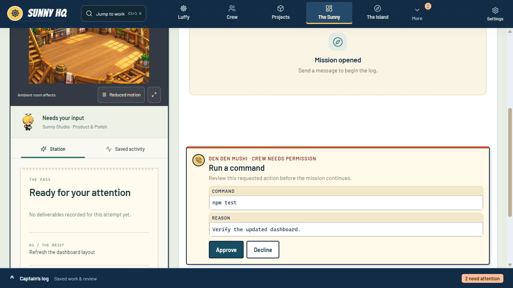
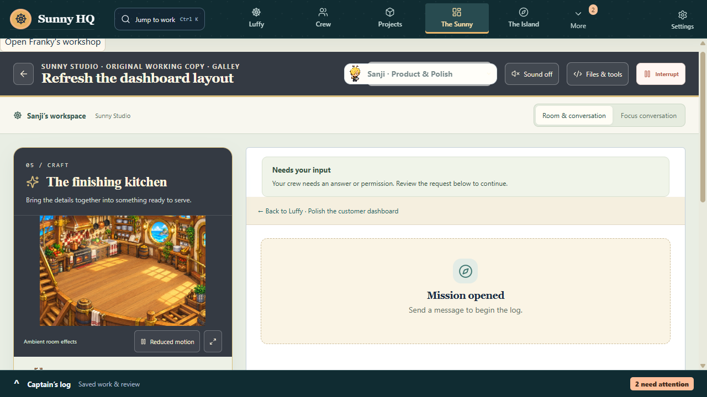
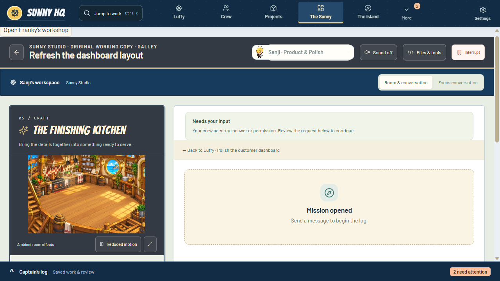
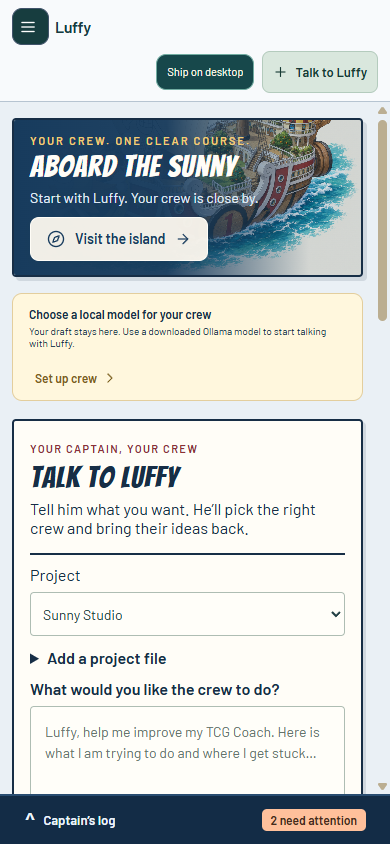
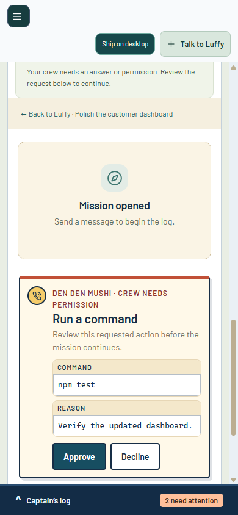
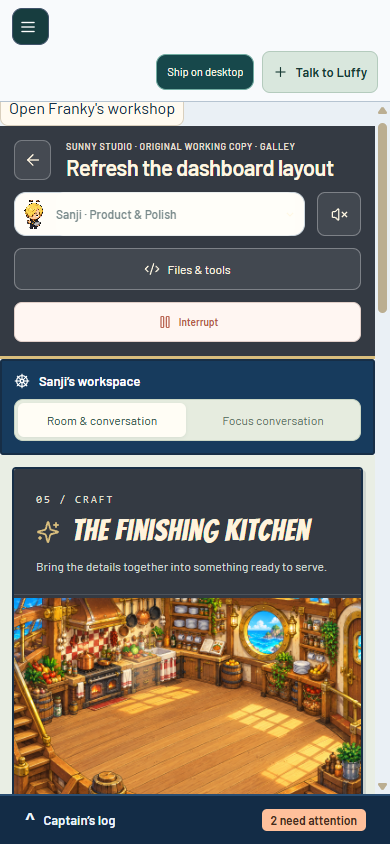
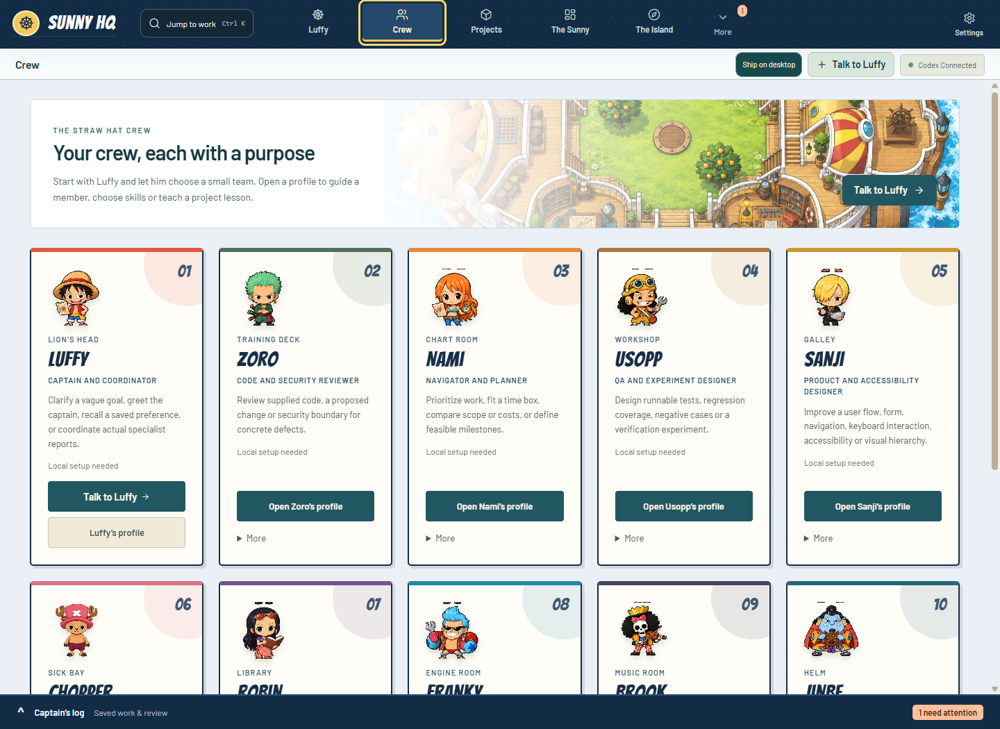

# Sunny shipboard comparison

November 6, 2026. These are hidden Electron captures with synthetic task data, not the installed app or live crew execution. Before: source `1fc7b80`. After: the isolated `codex/shipboard-design-20261106` visual changes. Desktop frames are 1280×720; phone frames are 390×844. The crew overview is 1440×1050.

| View | Before | After |
| --- | --- | --- |
| Captain home |  |  |
| Approval |  |  |
| Sanji's room |  |  |

| Phone home | Phone approval | Phone room |
| --- | --- | --- |
|  |  |  |

[Approval controls at 200% zoom](approval-200-percent.png) remain visible after scrolling to the actions; evidence and the request title can be reached in the same scroll region.

All ten room destinations, 200% zoom, system/Sunny reduced motion, approval submission and draft/editor preservation are covered by the full native fixture. The added capture probe also verifies loaded local fonts, zero remote resources, visible keyboard focus, and an 82,000-character transcript retaining its unsent draft. Raw receipts/logs and all-room screenshots remain under this worktree's `.sunny-dev/`.

See [decision, provenance, exact checks and limits](../../shipboard-design-2026-11-06.md). These screenshots use the project's existing generated fan artwork and do not establish a commercial license.
