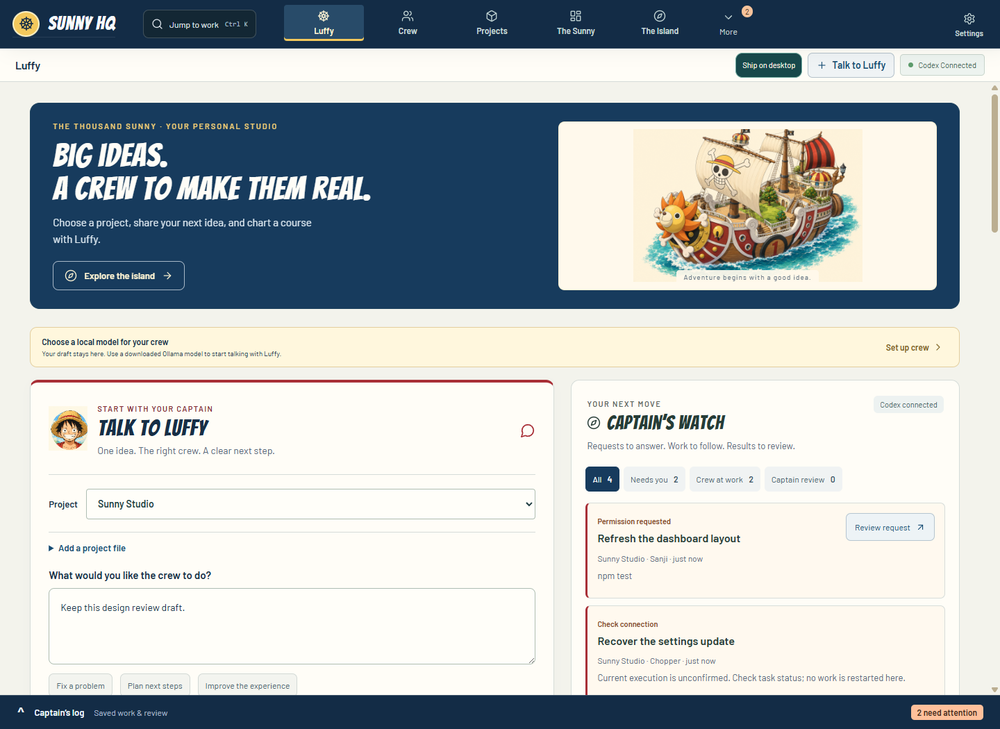
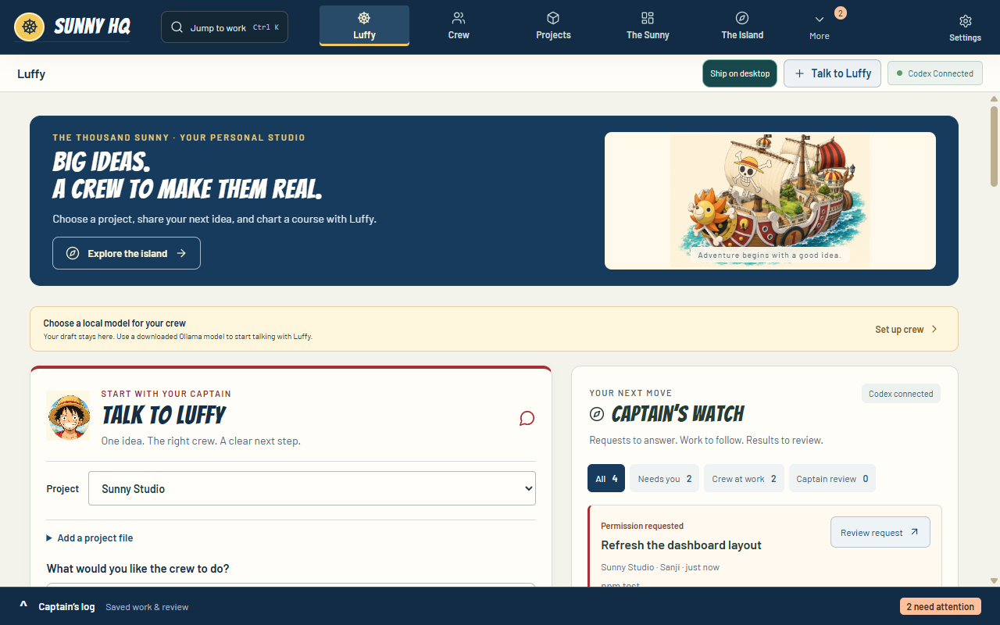
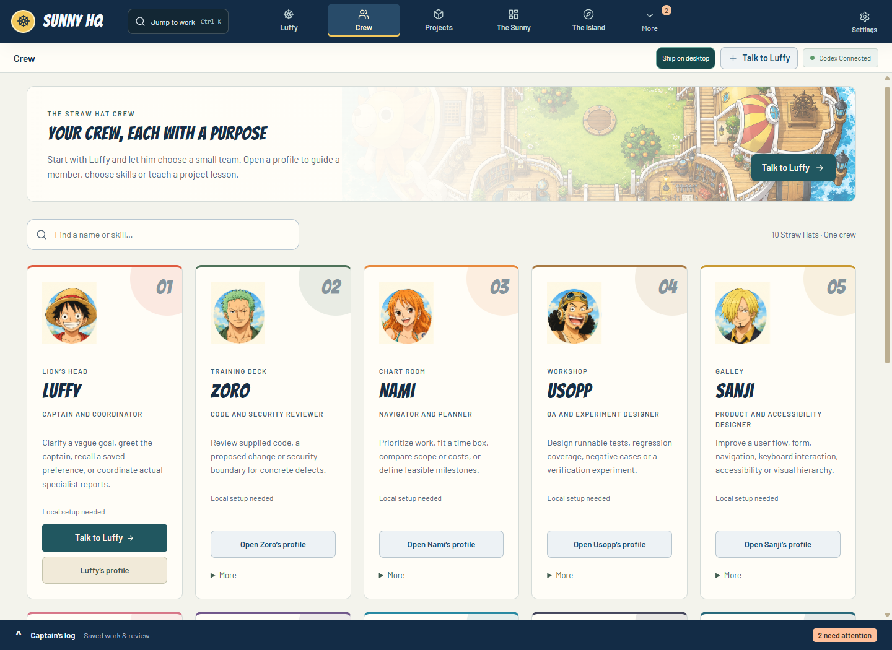
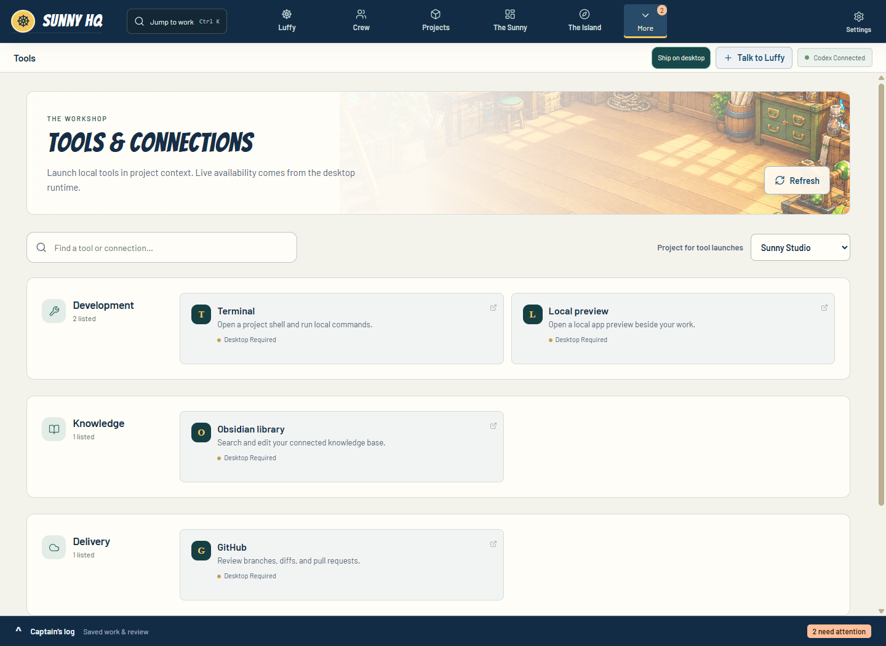

# Sunny studio preview

Native Electron captures, November 6, 2026. All project names, tasks, connection
states and requests shown here are isolated fixture data, not live work.
See the [design decision and validation](../../sunny-studio-design.md).

## Captain's dashboard

A clear brief, separate work watch, contained ship art and warm logbook surfaces.

[Phone dashboard](studio-home-phone.png)

## Crew directory

Search by name or specialty, recognizable portraits and direct profile actions.

[Remaining Straw Hats](studio-crew-second-row.png)

## Tools and compact layouts

Search tools and choose the project to launch them in. Header artwork stays
behind a readable text scrim on compact screens.

[Phone tools](studio-tools-phone.png) · [Phone settings](studio-settings-phone.png)

## Evidence boundary

The [studio checks](studio-result.json) cover responsive layouts, search/reset,
selected-project launch, draft preservation, zoom and reduced motion.
The [workflow checks](workflow-checks.json) cover 68 existing native interactions,
with a separate [process result](workflow-result.json).
Both final runs include the portrait correction and central Projects stylesheet
import fix. Neither proves live-provider
execution, installed-profile operation or screen-reader acceptance.

The [regression result](regression-result.json) records the completed serial
suite (1,731/1,732 passed), the inherited CSS-loader failure, and the successful
10-test rerun after its correction. No second full-suite green run is claimed.
