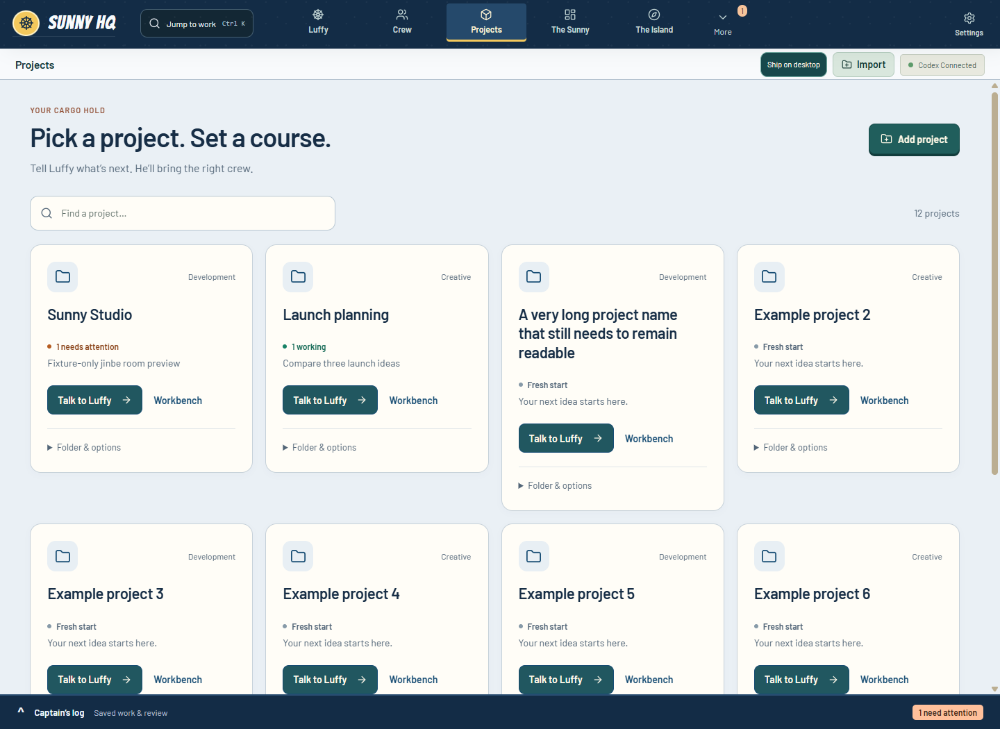

# Projects screen refresh — 2026-11-06

Requested by the captain: make Projects more modern, simpler and easier to follow. The screen retains Sunny's navy, cream and cargo-hold identity while replacing the large decorative card covers with compact folder icons and readable project names.

## Interaction

- Search matches project name, category and full folder path, without changing saved project order.
- Each card leads with Talk to Luffy, retaining the selected project. Workbench remains directly available.
- Activity comes from existing task summaries: attention takes precedence over working, otherwise the card says Saved activity or Fresh start. A saved or completed turn does not claim mission acceptance.
- Folder paths and removal sit inside a native keyboard-accessible disclosure. Removing a project requires confirmation; local files remain untouched by the existing registration-removal operation.
- Empty libraries and searches have distinct recovery actions. Cards wrap long names and collapse to one column on small screens.

No provider, model, persistence, IPC or permission changes. No new dependencies, remote resources or artwork. Projects has its own presentation component and scoped stylesheet; the other dashboard views retain their implementation.

## Validation

Evidence is recorded under ignored `.sunny-dev/projects-refresh-*` directories. The existing hidden Electron fixture now exercises search/no-results/reset, full folder disclosure, large libraries, long names, empty libraries, compact layout, 200% zoom and project-specific Luffy entry. These use synthetic projects and transport; they do not modify the daily profile or invoke a live model.

The hidden full workflow passed (exit 0) in `.sunny-dev/projects-refresh-verified`. Its 68 existing named checks include the expanded Projects coverage above. Desktop, compact and zoom captures were inspected. Two earlier runs are retained: both stopped at the new native Enter activation check because the fixture omitted the character event; the corrected key sequence passes without adding application keyboard handlers.

Clean checkout `728a1f6` passed `npm ci` and `npm run build`; build fingerprint `8687a90ab9b0b98d1f8d1176964763bf135b2ed2894d59b30638b15c2f58a6dc`. The unchanged dependency lock reports 12 audit findings (7 moderate, 5 high); no unrelated dependency upgrades were made. The existing large-bundle warning remains. No lint or screen-reader certification is claimed.

The normal-permission full regression run completed in 4,063,217 ms: **1,731 passed, 1 failed, no skips/cancellations**. The introduced failure was `external-history-ui.test.cjs`: its Node renderer imports `DashboardViews`, and the new component-level CSS import was parsed as JavaScript. Moved the stylesheet import to the existing central `main.tsx` style entry point. The failing test then passed, as did all 49 related renderer regressions and the production build. The full suite was not rerun after this import-only correction; its original failed receipt remains `.sunny-dev/projects-tests-elevated.log` rather than being relabeled green.

The initial sandbox attempt was stopped after temporary Git repository config writes were denied; that attempt is not a pass. The installed app remains on the previous merged version while this feature is reviewed on `codex/projects-refresh`.

Final corrected source `37bba58` passed a clean production build (fingerprint `9446a44b38a537c8ccadc07774ad87e2a36a4c070f19b08856119f0ca9cae74a`) and another complete hidden UI workflow (exit 0, `.sunny-dev/projects-refresh-corrected/result.json`). The final desktop/compact evidence below comes from that corrected run; the desktop capture was reinspected. Any integration based on initial commit `728a1f6` must also include the stylesheet-entry fix `37bba58`.

### Visual evidence

These captures use synthetic data, including the deliberately long name in the desktop library.

[Compact Projects layout](evidence/projects-2026-11-06/compact.png)

## Rollback

Revert the Projects component extraction, stylesheet and its dashboard re-export. No data rollback or migration is necessary. The fixture additions can be reverted independently. No issue was opened: this is a direct user-requested local UI change.
